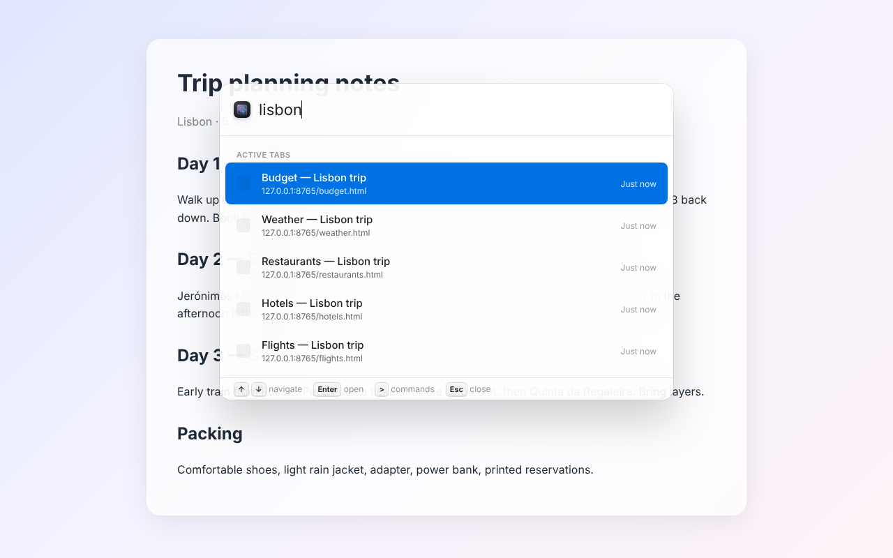
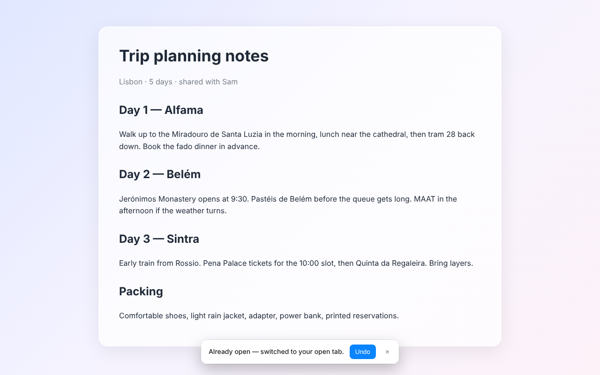
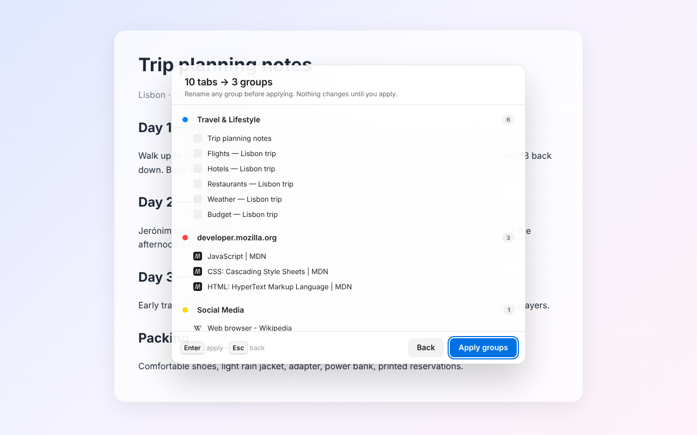
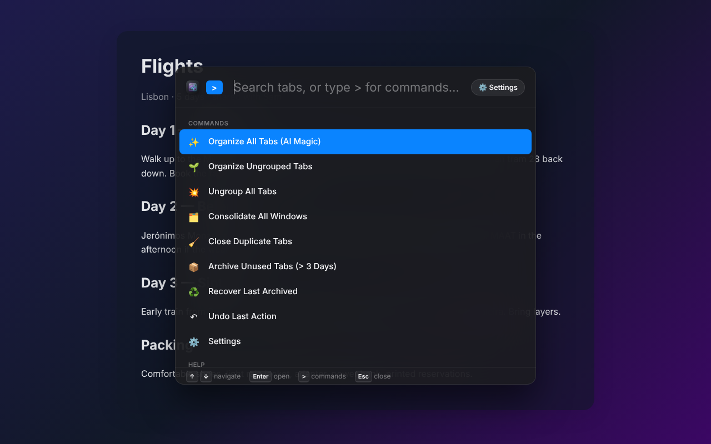
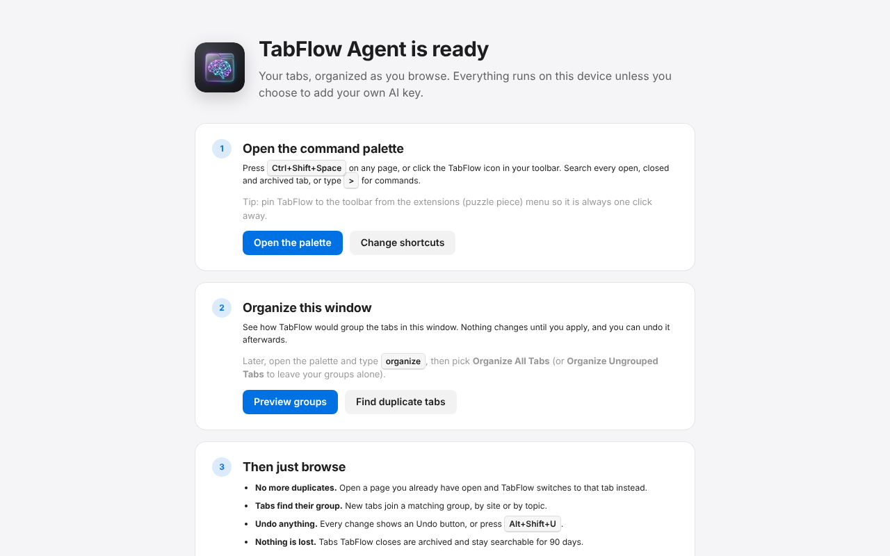

# 🌌 TabFlow Agent

[](https://chromewebstore.google.com/detail/tabflow-agent/mcejjnakabmfflpbjbffajjbooclihbg)
[](https://addons.mozilla.org/addon/tabflow-agent/)
[](LICENSE)
[](extension/manifest.json)

**TabFlow Agent keeps your browser tidy while you work, and never closes anything you can't get back.** It stops duplicate tabs, groups related tabs by topic, and finds any open, closed or archived tab from one keyboard shortcut. Everything runs on your device by default.

## 📥 Install

- 🌐 **Chrome, Edge, Brave and other Chromium browsers:** [Chrome Web Store](https://chromewebstore.google.com/detail/tabflow-agent/mcejjnakabmfflpbjbffajjbooclihbg)
- 🦊 **Firefox (142+):** [addons.mozilla.org/addon/tabflow-agent](https://addons.mozilla.org/addon/tabflow-agent/)
- 🌍 **Website:** https://snvishna.github.io/tabflow-agent/

A native Microsoft Edge Add-ons listing is coming soon; until then Edge users can install from the Chrome Web Store. Developers can also [install from source](#-install-from-source).



---

## ✨ Features

- **🧠 No duplicate tabs**: open a page that is already open and TabFlow switches to the existing tab, with an Undo notice. Only newly opened tabs are affected; browsing inside a tab is never interrupted, and different pages on the same site stay separate.
- **🌱 Grouping with preview**: "Organize All Tabs" proposes named groups by topic; rename any of them, then apply. Nothing changes until you do. New tabs join a matching group automatically (can be turned off).
- **↶ Undo anything**: closing duplicates, archiving, organizing and switching to an already-open tab can all be undone from the notice, the palette, or `Alt+Shift+U`.
- **🔍 Command palette**: `Ctrl+Shift+Space` (`Cmd+Shift+Space` on Mac), or the toolbar icon, searches open, recently closed and archived tabs. Type a few words in any order; titles and URLs both match. Type `>` for commands.
- **📦 Archive, don't lose**: archive tabs unused for N days (you choose; default 3), by hand or automatically with an hourly check (off by default). Every tab TabFlow closes stays searchable and restorable for 90 days.
- **📏 Site rules**: sites TabFlow must never close, and sites that should only ever have one tab (e.g. `localhost`, your webmail).
- **👋 Welcome page, tab-count badge, light & dark theme**, model download progress, activity log, and backup export/import.

| Duplicate switched, with Undo | Preview groups before applying |
|---|---|
|  |  |
| **Commands, in light or dark** | **Guided first run** |
|  |  |

---

## 🛡️ Privacy and AI

**Free and private by default.** Duplicate detection is a local URL match plus your site rules. Grouping uses a small open-source text-embedding model ([`Xenova/all-MiniLM-L6-v2`](https://huggingface.co/Xenova/all-MiniLM-L6-v2), about 25 MB) that runs in your browser: it is downloaded once from huggingface.co on first use and cached. No account, no telemetry, nothing sent to us.

### 🔑 Bring your own AI key (optional)

TabFlow works fully without a key. Add one from a provider you already use and it takes over grouping (smarter group names) and/or the duplicate decision for different pages on the same site. You pay the provider directly for the tokens you use.

1. Press `Ctrl/Cmd+Shift+Space`, type `>`, choose **Settings**.
2. Paste your key into **Main API Key**. TabFlow detects the provider and fills in its endpoint and default model.
3. Optional: turn on **Use split engines** to use a different key, endpoint or model for each engine.

| Provider | Key starts with | Used for | Default model |
|---|---|---|---|
| [Claude (Anthropic)](https://console.anthropic.com/settings/keys) | `sk-ant-` | Grouping & duplicates | `claude-haiku-5-5` |
| [OpenAI](https://platform.openai.com/api-keys) | `sk-` | Grouping & duplicates | `gpt-4.1-mini` |
| [Gemini (Google)](https://aistudio.google.com/apikey) | `AIza` / `AQ` | Grouping & duplicates | `gemini-3.6-flash` |
| [Jev (TypeSafe)](https://typesafe.ai) | `apikey_` | Duplicates only (fast classifier) | `jev-latest` |
| Any OpenAI-compatible API (Groq, Together…) | anything | Grouping & duplicates | enter Base URL + model under split engines |

- **Cognitive Engine (grouping)**: a generative model names and organizes your tabs into groups. Falls back to the on-device model if the call fails.
- **Reflex Engine (duplicates)**: when a new tab opens a different page on a site you already have open, a fast model decides whether to reuse the existing tab (single-instance apps like dashboards or webmail) or keep both (products, docs, search). Decisions are cached; if the call fails, both tabs stay open.
- A Jev key in **Main API Key** powers duplicates only; grouping keeps using the on-device model. A typical setup is Claude/OpenAI/Gemini as the main key and Jev as the separate Reflex key.
- **Settings → Activity Log** shows each AI decision with token counts.

With a key set, only tab titles and URLs are sent, and only to the provider you chose. See [PRIVACY_POLICY.md](PRIVACY_POLICY.md).

---

## ⌨️ Shortcuts & Commands

- **Open palette**: `Cmd+Shift+Space` (Mac) or `Ctrl+Shift+Space` (Windows/Linux), or click the toolbar icon.
- **Undo last action**: `Alt+Shift+U`.
- Change shortcuts in the palette under **Settings → Toolbar & Shortcuts**, or at `chrome://extensions/shortcuts` / Firefox's **Manage Extension Shortcuts**. If a shortcut is already taken, the welcome page and Settings show "Not set" with a button to pick another.

Inside the palette, type `>` for commands:
- `✨ Organize All Tabs (AI Magic)` and `🌱 Organize Ungrouped Tabs` (with preview)
- `🧹 Close Duplicate Tabs` (with preview)
- `📦 Archive Unused Tabs` (with preview; the number of days is a setting)
- `💥 Ungroup All Tabs`, `🗂️ Consolidate All Windows`, `♻️ Recover Last Archived`, `↶ Undo Last Action`
- `💾 Export Backup` / `📥 Import Backup`, `⚙️ Settings`, `👋 Welcome, Tips & Shortcuts`

**Settings → Activity Log** shows every decision TabFlow made in the last 7 days, with search (and, with an API key, token usage and model confidence).

---

## 🚀 Install from source

Most people should install from the [Chrome Web Store](https://chromewebstore.google.com/detail/tabflow-agent/mcejjnakabmfflpbjbffajjbooclihbg) or [Firefox Add-ons](https://addons.mozilla.org/addon/tabflow-agent/). To build it yourself (requires Node.js 22 and npm 10+):

```bash
git clone https://github.com/snvishna/tabflow-agent.git
cd tabflow-agent/extension
npm ci
npm run build          # bundles src/background.js into dist/ with esbuild
```

**Chrome / Edge / Brave:**
1. Open `chrome://extensions/` (or `edge://extensions/`, `brave://extensions/`).
2. Enable **Developer mode**.
3. Click **Load unpacked** and select the `extension` folder.

**Firefox (142+):** install from [AMO](https://addons.mozilla.org/addon/tabflow-agent/), or for development run `bash scripts/pack.sh` from the repo root, open `about:debugging#/runtime/this-firefox`, click **Load Temporary Add-on…** and pick `build/firefox-dev/manifest.json`.

> **Keep your API keys across reloads.** Firefox gives a temporary add-on empty storage each time it is loaded, so keys typed into Settings don't survive. Copy `extension/config.example.json` to `extension/config.json` (git-ignored, never packaged for the stores) and put your keys there; `build/firefox-dev/` includes it and TabFlow fills Settings from it on install.

---

## 🛠️ Architecture & Development

- **UI**: vanilla JS, HTML and CSS. The palette is an isolated `iframe` overlay; light and dark themes share `src/theme.css`.
- **Background**: an MV3 service worker (`src/background.js`) handles navigation events, grouping, archiving, undo and the badge. No remote code: the WebAssembly AI runtime is bundled.
- **Storage**: IndexedDB via `Dexie.js` for the 90-day archive and 7-day activity log; `storage.local` for settings; `storage.session` for undo history.
- **Cross-browser**: one codebase; `scripts/pack.sh` produces the Chrome/Edge and Firefox packages from the same manifest.

More detail in [docs/architecture.md](docs/architecture.md), [docs/faq.md](docs/faq.md), and [docs/requirements.md](docs/requirements.md).

### Running tests
```bash
cd extension
npm test                                       # unit tests (vitest)
CHROME_BIN=... FF_BIN=... npm run test:e2e     # installs the packed ZIPs in Chromium and Firefox
```
See [`extension/e2e/README.md`](extension/e2e/README.md). Run the end-to-end suites before every store submission.

### Packaging for the stores
```bash
bash scripts/pack.sh   # tabflow-chrome.zip, tabflow-firefox.zip, tabflow-source.zip
```
Store listing copy lives in [CHROMEWEBSTORE.md](CHROMEWEBSTORE.md), [FIREFOX_ADDONS.md](FIREFOX_ADDONS.md) and [MICROSOFT_EDGE.md](MICROSOFT_EDGE.md); screenshots are in `store-assets/`. The website is `docs/` (GitHub Pages).

## 📜 License
[MIT](LICENSE)
