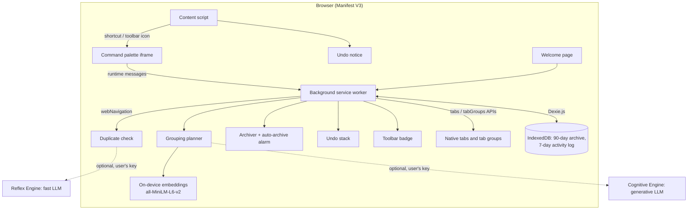

# System Architecture

TabFlow Agent is a Manifest V3 extension with one codebase for Chromium browsers and Firefox. Everything runs inside the browser; the only optional network dependency is an AI provider the user configures with their own key.

## Component Diagram

## Components

### 1. Command palette (`palette.html`, `src/palette.js`, `src/preview.js`)
- Injected as an `iframe` overlay by `src/content.js`, so the host page's CSS can't break it (and vice versa).
- Fuzzy search across open tabs, recently closed tabs (`sessions`) and the archive; `>` switches to commands.
- Previews for grouping, closing duplicates and archiving: the background returns a *plan*, the palette shows it (groups can be renamed), and only "Apply" changes anything.
- Settings: archive days, auto-archive, auto-grouping, site rules, toolbar badge, shortcuts, and the optional API keys.

### 2. Background service worker (`src/background.js`)
- **Duplicate check** (`webNavigation.onBeforeNavigate`): only for *fresh* tabs (newly opened, not navigations inside an existing tab), only for web URLs, and never for "never close" sites.
  1. Exact match (normalized URL) → switch to the existing tab.
  2. If the Reflex Engine is configured: ask it whether a different page on the same site should reuse the open tab (`REFRESH`) or open alongside it (`NEW_TAB`). Decisions are cached per URL pair in `storage.session`.
  3. Otherwise, "one tab per site" rules reuse the existing tab for those sites.
  Every switch shows an Undo notice; the closed new tab is restorable.
- **Grouping** (`planGrouping` / `applyGroupPlan`): the Cognitive Engine if configured, else on-device clustering (`src/clustering.js`). "Ungrouped only" mode leaves existing groups alone.
- **Auto-grouping** (`src/autogroup.js`): when a new tab finishes loading, it joins the most similar existing group above a similarity threshold.
- **Archiving**: tabs unused for the chosen number of days are saved to IndexedDB and closed; an optional hourly `alarms` job does this automatically.
- **Undo** (`src/undo.js`): every action records how to reverse it (reopen tabs, restore group snapshot). Entries live in `storage.session` for 30 minutes.
- **Badge** (`src/badge.js`): tab count on the toolbar icon (optional), or a hint when the shortcut is unassigned.

### 3. On-device AI (`src/clustering.js`)
- `@xenova/transformers` runs `Xenova/all-MiniLM-L6-v2` in WebAssembly inside the service worker. The ONNX runtime files are bundled into `dist/` by `build.mjs`; the model weights (~25 MB) are downloaded from huggingface.co on first use and cached. Download progress is reported to the preview UI.
- Each tab's title + hostname is embedded; tabs are clustered greedily by cosine similarity with a bonus for the same domain, and each cluster gets a short name.

### 4. Optional remote AI (`src/providers.js`, `src/prompts.js`)
- The provider (Anthropic, OpenAI, Gemini, TypeSafe) is detected from the key prefix, which fills a default endpoint and model. Any OpenAI-compatible endpoint can be set in advanced settings, separately for each engine.
- Calls time out after 15 s. If the Cognitive Engine fails, grouping falls back to on-device clustering; if the Reflex Engine fails, both tabs stay open. Outcomes are written to the activity log.

### 5. Storage
| Store | Contents | Lifetime |
|---|---|---|
| IndexedDB (`src/db.js`, Dexie) | Archived/closed tabs; activity log | 90 days; 7 days |
| `storage.local` | Settings, site rules, API keys | Until changed or uninstalled |
| `storage.session` | Undo history, reflex cache, fresh-tab tracking | Until the browser closes |

### 6. Cross-browser
- `const browserAPI = typeof browser !== "undefined" ? browser : chrome;` everywhere.
- `scripts/pack.sh` builds once and creates per-browser packages from a pristine manifest each time: Chrome/Edge get `background.service_worker` and no `browser_specific_settings`; Firefox gets `background.scripts` and keeps its gecko settings.
